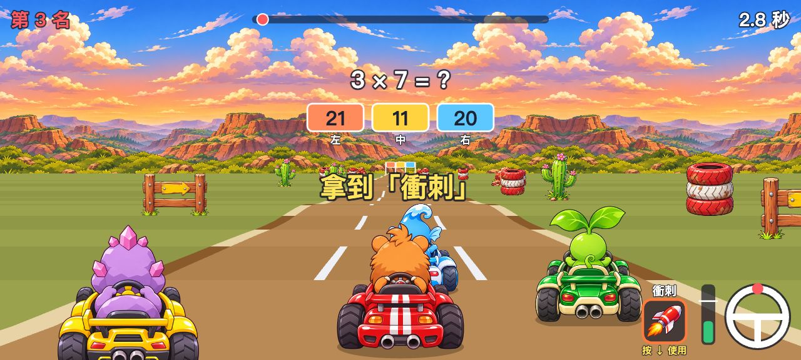
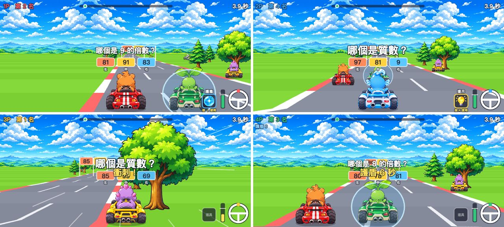

# 鏡頭數學賽車 Camera Kart Math

用筆電鏡頭玩的數學賽車：雙手握「空氣方向盤」轉彎，開過正確答案的閘門就會衝刺。全部在瀏覽器裡執行，不用安裝，鏡頭畫面不會上傳。

A webcam-controlled math kart racer that runs entirely in the browser. Hold an imaginary steering wheel, drive through the gate with the right answer. No install, and the camera image never leaves your computer.

**直接玩：<https://iweilai0924.github.io/camera-kart-math/>**（用 Chrome 或 Edge 開啟，允許使用攝影機）




## 怎麼玩

| 動作 | 效果 |
|---|---|
| 雙手像握方向盤一樣舉在胸前，往左或往右傾斜 | 轉彎 |
| 方向盤拿高（到肩膀高度） | 加速；放低到肚子就不加速 |
| 開過正確答案的閘門 | 衝刺，並拿到一個道具 |
| 開過路上的寶箱 | 拿到一個道具（手上最多存一個） |
| 雙手舉過頭 | 使用道具 |
| 還沒開始時，雙手舉過頭 0.7 秒（或按空白鍵） | 開始比賽 |
| 還沒開始時，方向盤往左或往右打到底 | 換一台車 |

只需要拍到上半身。大約站在離鏡頭 1 到 2 公尺，畫面左下角的小視窗看得到雙手就可以。

### 道具

| 道具 | 效果 |
|---|---|
| 衝刺 | 加速 3 秒 |
| 護盾 | 6 秒內答錯不減速、撞到東西不會停 |
| 香蕉皮 | 丟在自己車後的那個車道；後面的車踩到會往右滑一個車道，並打滑 1.5 秒 |
| 提示 | 下一個答案閘門的正解會亮起來 |

開出路外撞到樹或石頭，會暫停 1.5 秒。

### 可以調整的項目（畫面上方的按鈕）

- **人數**：1 到 4 人。2、3 人左右並排，4 人田字形；站在畫面最左邊的人是 1P。
- **賽道**：草原（簡單）、海邊（一般）、越野（難，路面顛簸）、雪地（難，路滑）。
- **題目**：20 以內加減、九九乘法、質數與倍數、不出題。
- **油門**：拿高（預設）、踏步（原地踏步越快車越快，需要拍到膝蓋）、自動。
- **車**：紅車（均衡）、藍車（極速快）、黃車（加速快）、綠車（過彎穩）。

### 鍵盤

| 按鍵 | 功能 |
|---|---|
| 空白鍵 | 開始／重來 |
| C | 切換鏡頭 |
| F | 全螢幕 |
| H | 說明 |
| T | 鍵盤試玩（不用鏡頭） |

鍵盤試玩時，四位玩家的按鍵依序是「左、右、加速、用道具」：1P `← → ↑ ↓`、2P `J L I K`、3P `A D W S`、4P `4 6 8 5`。

### 網址參數

可以在網址後面加參數，直接開成想要的設定，例如 `?players=2&track=snow&level=add`。

| 參數 | 值 |
|---|---|
| `players` | `1`–`4` |
| `track` | `meadow`、`beach`、`offroad`、`snow` |
| `level`（以及 `level2`–`level4`） | `add`、`mul`、`prime`、`off` |
| `gas` | `high`、`step`、`auto` |
| `karts` | 每位玩家的車，例如 `dcba` |
| `model` | `n`：改用較小、較快的辨識模型 |
| `cpu` | 加上 `cpu=1` 強制不用顯示卡加速（測試用） |
| `test` | 加上 `test=1` 一開始就是鍵盤試玩 |

## 需要什麼

- 有鏡頭的電腦（Windows 或 Mac 都可以）。
- 新版的 Chrome 或 Edge。瀏覽器支援 WebGPU 時用顯示卡加速辨識；不支援時會自動改用 CPU 跑較小的模型，可以玩，但辨識會比較慢。
- 第一次開啟要下載辨識模型與執行元件（合計約 70 MB），之後瀏覽器會快取。

## 隱私

鏡頭畫面只在你的電腦上辨識，不會上傳到任何地方。遊戲也不會存下影像；只有最佳成績會記在瀏覽器裡。

## 不連網路也能玩

下載整個專案（Code → Download ZIP）後解壓縮：

- **Windows**：雙擊 `start-windows.bat`。它用 Windows 內建的 PowerShell 開一個只給本機用的小伺服器，再用瀏覽器開啟遊戲。
  這個啟動檔還沒有在 Windows 實機上測過，如果打不開，請改用上面的網址。
- **Mac**：雙擊 `start-mac.command`（需要 Python 3 與 Chrome）。

直接雙擊 `index.html` 是開不起來的，瀏覽器不允許從檔案路徑開鏡頭與載入模型。

## 檔案

| 檔案 | 內容 |
|---|---|
| `index.html` | 外框：開鏡頭、把辨識結果交給賽車、按鈕與鍵盤 |
| `race.js` | 賽車本身：賽道、物理、題目、道具、畫面 |
| `pose-worker.js` | 姿態辨識，在背景執行緒執行，畫面才不會被拖慢 |
| `models/` | YOLOv8-pose 姿態辨識模型 |
| `vendor/ort/` | ONNX Runtime Web |
| `assets/race/` | 車子、道具、賽道的圖 |
| `test/r.mjs` | 自動檢查 |

## 自動檢查

```
python3 server.py 8932
node test/r.mjs /tmp/camera-kart-test
```

需要 Node 22 以上與 Google Chrome。它用無頭 Chrome 把每一條操作路徑跑一遍，其中玩家的動作是用合成的關節資料模擬的。

## 目前的限制

- 方向盤的靈敏度、拿高加速的高度範圍，還沒有在很多真人身上調整過。
- 四個人並排時，要站遠一點鏡頭才拍得下。
- 辨識模型在光線很暗、或背景有很多人時會比較不準。

## 授權

程式以 [AGPL-3.0](LICENSE) 授權公開。姿態辨識模型來自 Ultralytics YOLOv8（AGPL-3.0），這也是整個專案採用 AGPL-3.0 的原因。圖片是用 AI 影像生成工具製作的原創設計。詳見 [THIRD-PARTY.md](THIRD-PARTY.md)。
